# 基于 SpringBoot + Vue 的龙湖游船预约系统的设计与实现

> 本文围绕龙湖景区游船预约业务，设计并实现了一套基于 SpringBoot + Vue 的游船预约管理系统，涵盖用户端与管理员端，实现了游船信息展示、在线预约、订单管理、评价审核等核心功能。

## 一、项目背景

龙湖景区是当地热门的水上游览景点，日常接待大量游客。传统的游船预约依赖人工登记和电话沟通，存在效率低、易出错、管理不透明等问题。本项目旨在通过数字化手段，为游客提供便捷的在线预约体验，同时为景区管理员提供高效的订单与游船资源管理工具，提升景区整体运营效率。

## 二、功能模块介绍

系统分为两个端：用户端和管理员端。

| 系统端 | 角色 | 描述 |
| --- | --- | --- |
| 用户端 | 用户 | 注册登录、浏览游船、预约游船、管理个人信息与订单 |
| 管理员端 | 管理员 | 用户管理、游船信息管理、预约时间管理、订单管理、评价管理 |

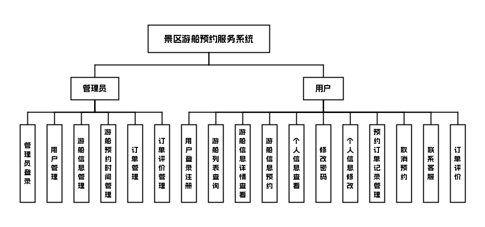

## 三、技术栈说明

前端：Vue

后端：Java, SpringBoot

数据库与中间件：MySQL

## 四、核心模块介绍

###### 用户端

###### 用户

- 功能点表格

| 功能模块 | 功能点 | 功能说明 |
| --- | --- | --- |
| 用户登录注册 | 注册 | 游客注册账号 |
| 用户登录注册 | 登录 | 已注册用户登录系统 |
| 游船列表页 | 游船展示 | 展示所有可预约的游船信息 |
| 游船信息详情页 | 详情展示 | 展示单条游船的详细信息 |
| 游船信息预约 | 预约操作 | 用户选择游船、预约时间与数量进行预约 |
| 个人信息页 | 修改密码 | 用户修改登录密码 |
| 个人信息页 | 个人信息修改 | 用户修改个人资料 |
| 预约订单记录管理 | 取消预约 | 用户取消未开始的预约订单 |
| 预约订单记录管理 | 联系客服 | 点击跳转客服联系方式页，展示客服电话和邮箱 |
| 预约订单记录管理 | 订单评价 | 用户对已完成的订单进行评价 |

##### 界面展示

登录页：用户可在此登录或注册游船预约系统账号

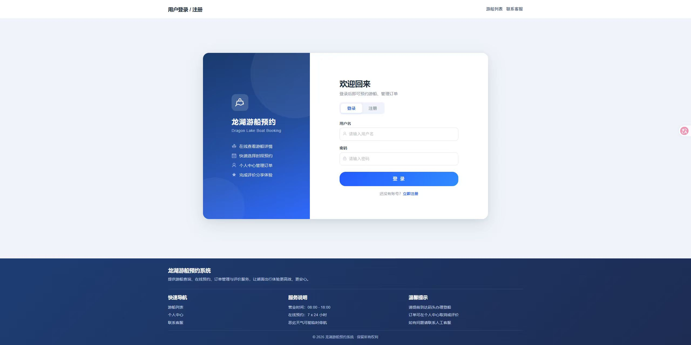

注册页：填写信息完成龙湖游船预约系统账户注册

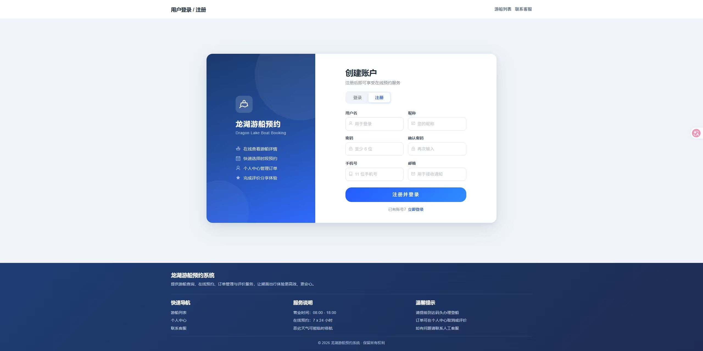

游船列表页：展示游船列表，可搜索、查看详情和在线预约

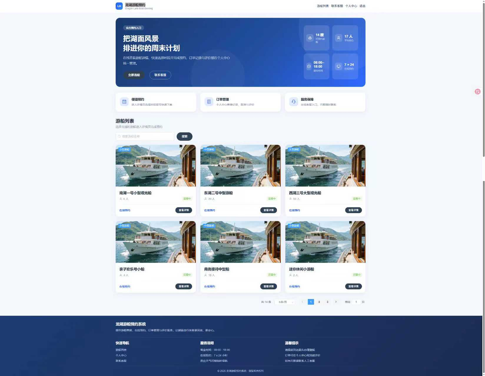

游船信息详情页：展示游船详情，支持用户预约该游船

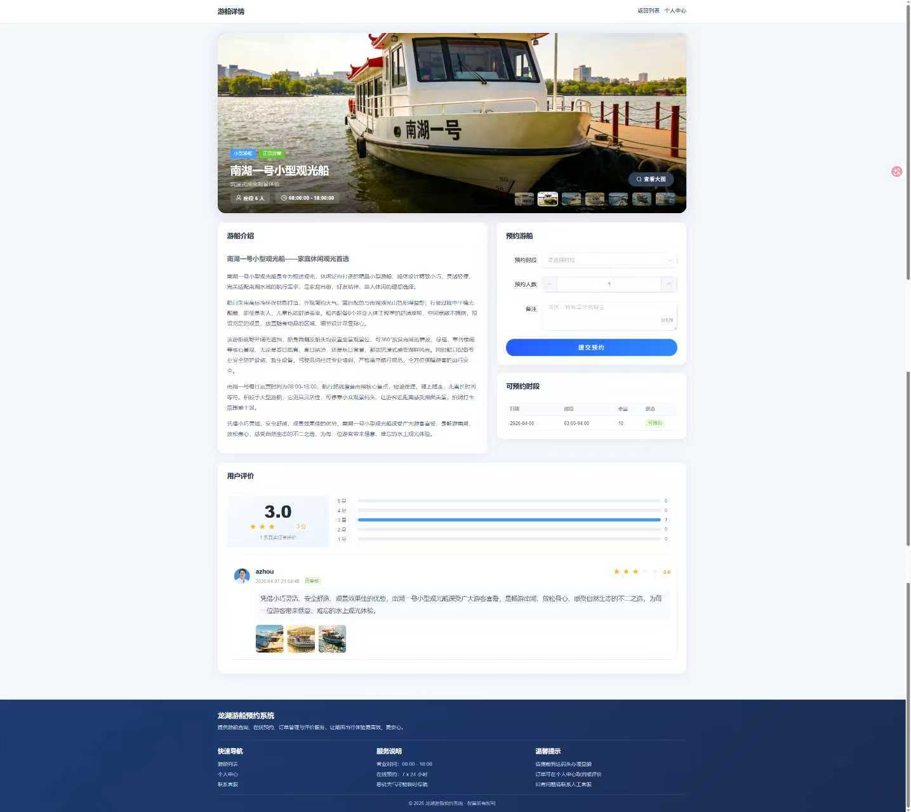

个人信息页：修改个人信息密码，管理个人预约订单

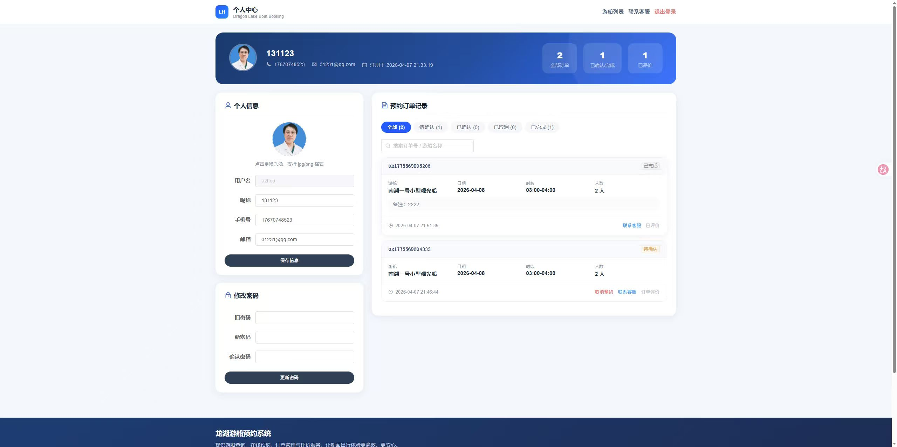

客服中心页：展示客服信息、常见问题和平台服务保障内容

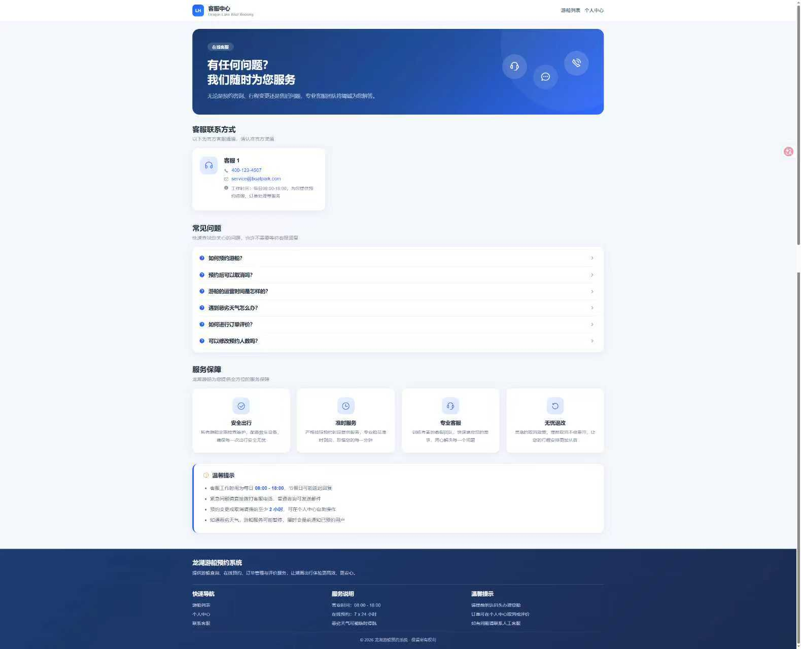

###### 管理员端

###### 管理员

- 功能点表格

| 功能模块 | 功能点 | 功能说明 |
| --- | --- | --- |
| 管理员登录 | 登录 | 管理员账号登录系统 |
| 用户管理 | 用户管理 | 查看和管理所有注册用户信息 |
| 游船信息管理 | 游船管理 | 添加、编辑、删除游船信息 |
| 游船信息管理 | 运营时间 | 设置游船的运营时间段 |
| 游船预约时间管理 | 预约时间设置 | 设置每日的预约时间段 |
| 游船预约时间管理 | 预约数量设置 | 设置每日可预约的游船数量 |
| 订单管理 | 订单查看 | 查看所有游客的预约订单及订单状态 |
| 订单管理 | 异常订单处理 | 对异常订单进行人工干预处理 |
| 订单评价管理 | 审核评价 | 审核用户提交的评价，审核通过后可展示在游船信息页 |

##### 界面展示

系统首页：展示游船预约系统各类业务数据统计

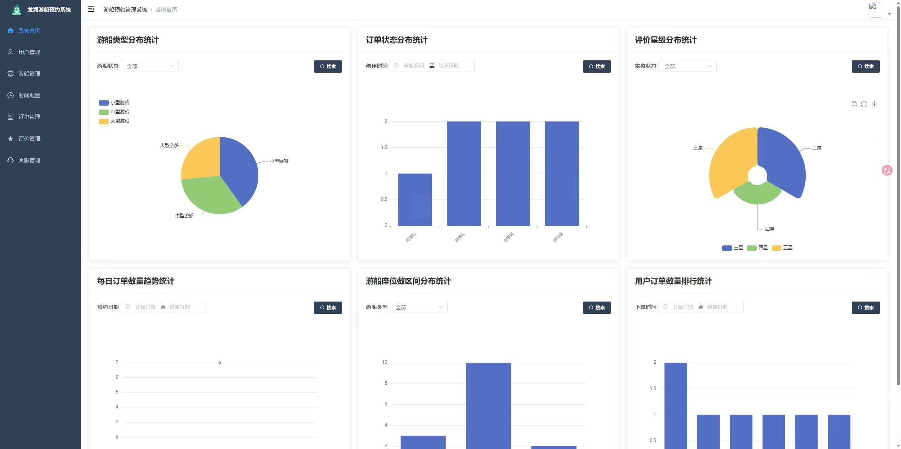

登录页：管理员输入信息登录龙湖游船预约系统

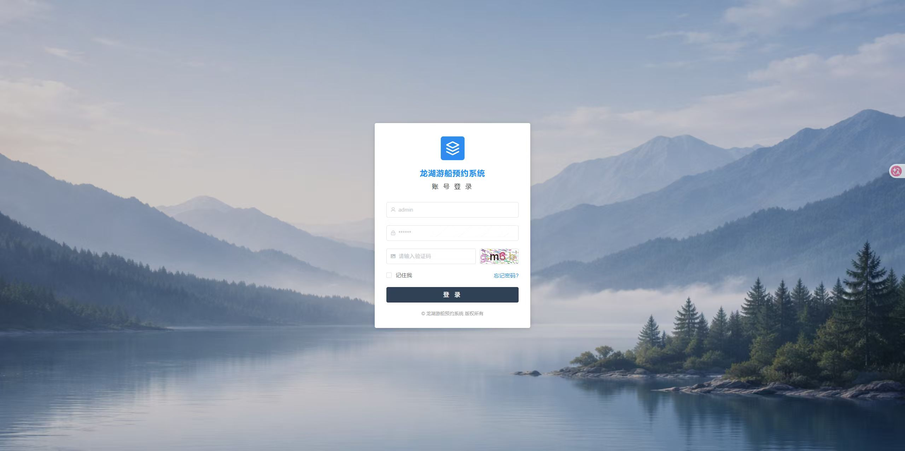

用户管理页：管理员查询和管理系统内的用户信息

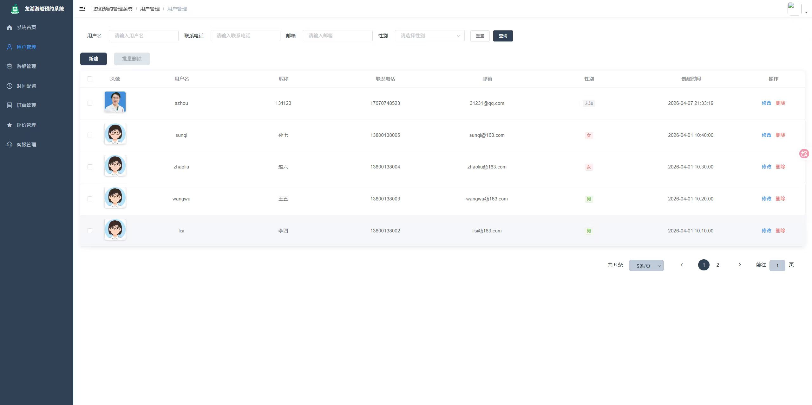

游船信息管理页：管理员查看和管理系统内所有游船的信息

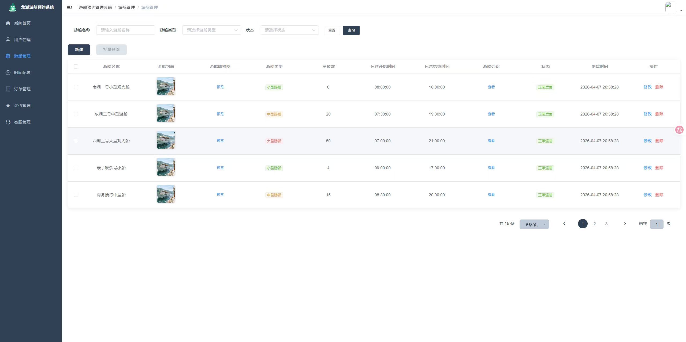

预约时间管理页：管理游船可预约时间与可预约数量信息

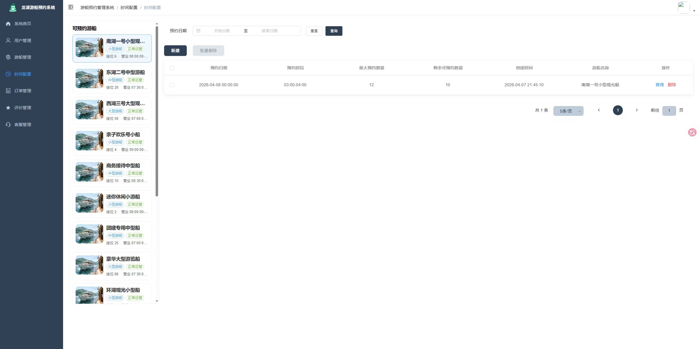

订单管理页：查看所有预约订单，对异常订单进行人工处理

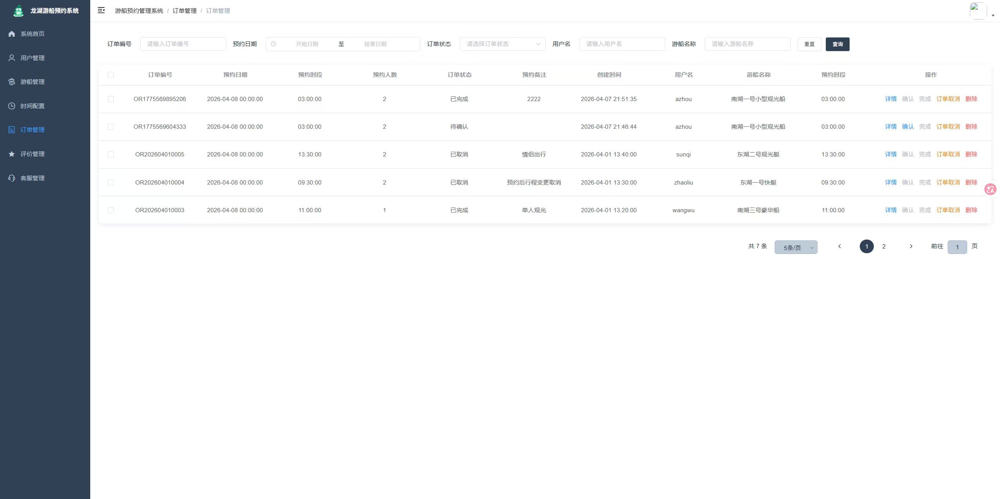

评价管理页：审核管理用户提交的游船评价

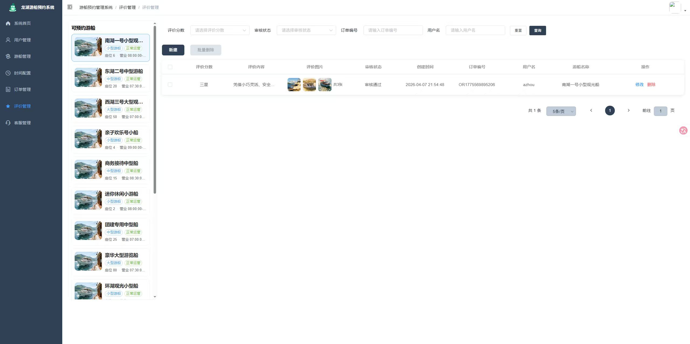

客服管理页：展示并管理客服联系信息，支持增删改操作

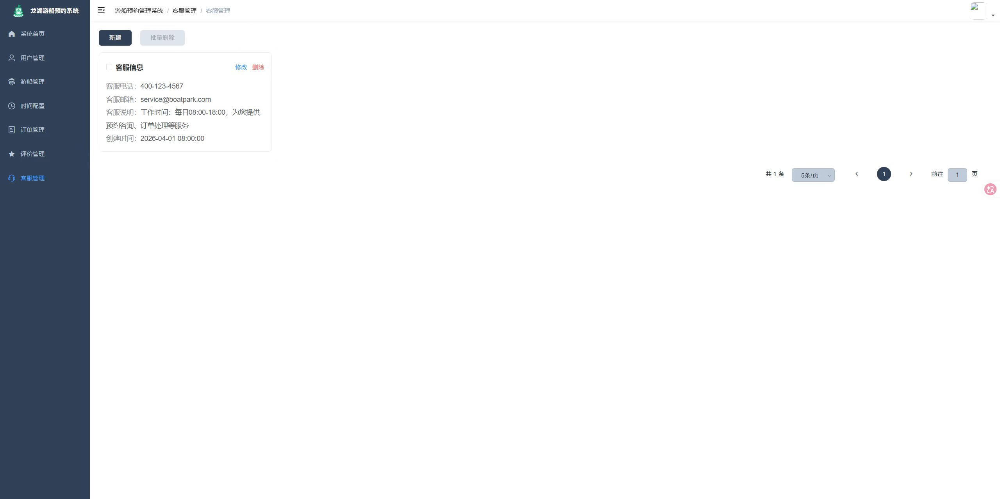

## 五、主要业务流程

1. 游客访问系统，注册或登录账号。
2. 游客浏览游船列表页，查看可预约的游船信息。
3. 游客点击游船进入详情页，查看详细信息。
4. 游客选择预约时间与预约数量，提交预约申请。
5. 系统生成预约订单，订单状态默认为待确认。
6. 管理员登录系统，查看所有订单信息。
7. 管理员对异常订单进行人工处理。
8. 游客在个人中心查看订单记录。
9. 游客可对已完成的订单进行评价。
10. 管理员审核评价内容，审核通过后评价展示在游船信息页。

## 六、项目拓展性

- 可拓展在线支付功能，支持微信、支付宝等支付方式，实现预约后自动锁单。
- 可增加智能排班功能，根据游船运营时间与历史预约数据，自动调整每日预约数量。
- 可拓展数据统计模块，为景区提供游船使用率、热门时段等运营数据分析。
- 可增加消息推送功能，预约成功或订单变动时通过短信或小程序通知用户。

## 代码说明 
本仓库为项目的 **后端核心代码部分** 主要用于展示系统的业务设计思路与后端实现方式 出于学习展示与版权保护考虑 前端实现、完整数据库脚本及部署配置未在本仓库中公开 

##  项目交流 
本项目用于学习展示 如需项目完整功能演示、答辩说明或技术交流 请前往作者 GitHub 主页查看联系方式